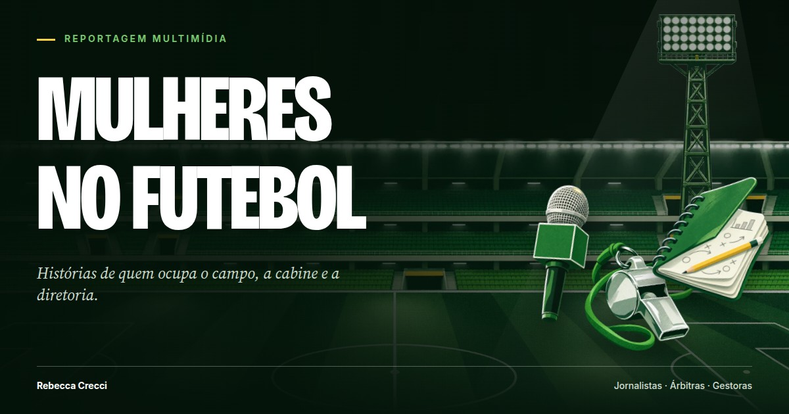

# Mulheres no Futebol

> O microfone na mão, o crachá no pescoço, o apito no peito.

**[Acesse a reportagem →](https://mulheres-no-futebol.vercel.app/)**

**Mulheres no Futebol** reúne as trajetórias de sete profissionais do jornalismo, da arbitragem e da gestão que atuam no futebol masculino no Brasil. Uma reportagem multimídia de **Rebecca Crecci** sobre a paixão pelo esporte, os desafios da profissão e a conquista de espaço em um ambiente historicamente dominado por homens.

## Escolha por onde entrar em campo

A experiência começa em um estádio à noite. Sobre o gramado, três objetos abrem caminhos para conhecer as entrevistadas:

- **[As Jornalistas](https://mulheres-no-futebol.vercel.app/#jornalistas)** · O microfone leva às histórias de **Carla Pessoa, Nana Ednet e Mariana Fraga**.
- **[As Árbitras](https://mulheres-no-futebol.vercel.app/#arbitras)** · O apito apresenta as trajetórias de **Edina Alves e Cassia França**.
- **[As Gestoras](https://mulheres-no-futebol.vercel.app/#gestoras)** · A caderneta abre os bastidores da gestão com **Mirian Monte e Marianna Líbano**.

Você pode seguir qualquer caminho, voltar ao estádio e descobrir outras histórias. Também pode [começar pela abertura da reportagem](https://mulheres-no-futebol.vercel.app/#abertura), que apresenta o contexto do projeto.

## Uma experiência para explorar e ler

O estádio tem movimento, sons opcionais e detalhes para descobrir. Nas histórias, a leitura ganha espaço, com falas em destaque, trechos de áudio e sugestões para continuar. A experiência se adapta ao celular e ao computador.

## Sobre o projeto

Desenvolvido como **Trabalho de Conclusão de Curso em Jornalismo**.

- **Reportagem e textos:** Rebecca Crecci.
- **Desenvolvimento do site:** [Caio Bezerra](https://github.com/CaioBezerra-Dev).

---

As orientações de edição, execução local e publicação estão no [Guia técnico](GUIA_TECNICO.md).
